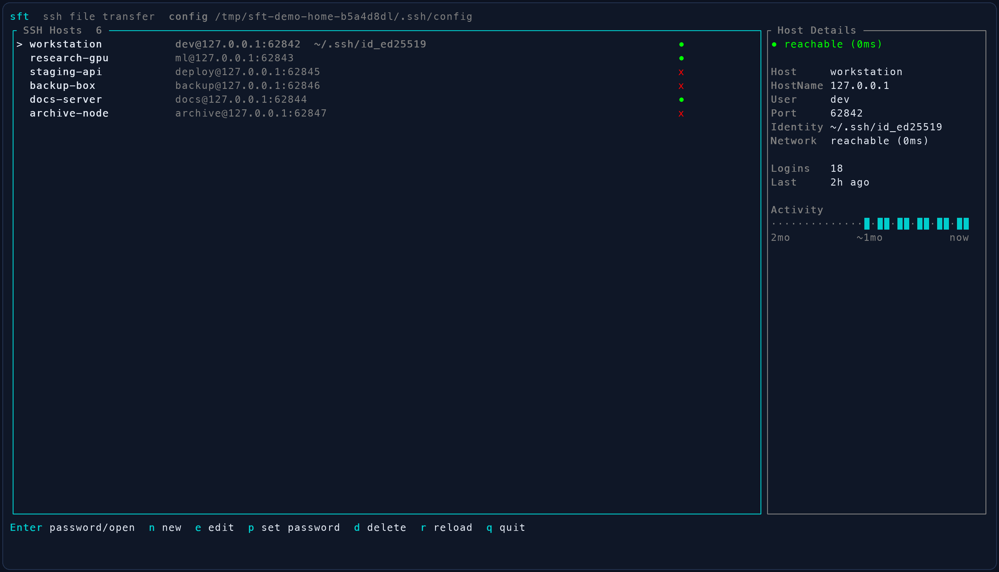
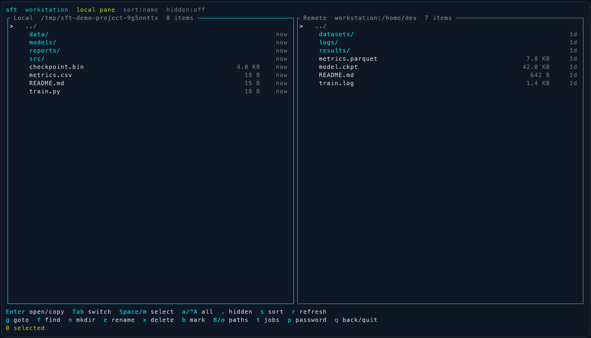

# sft

`sft` is a small Rust TUI for choosing an SSH config host and moving files between your serves.


## Preview





## Install

```sh
cargo install sft
```

For local development:

```sh
cargo install --path path/to/install
```

## Usage

```sh
sft
```


## Keys

Host picker:

| Key | Action |
| --- | --- |
| `Enter` | Show password popup, then open selected host |
| `n` | Add a Host block |
| `e` | Edit selected single-alias Host block |
| `p` | Set or clear the selected host's session password |
| `d` | Delete selected single-alias Host block |
| `r` | Reload ssh config |
| `q`, `Esc` | Quit |

Host form:

| Key | Action |
| --- | --- |
| `Tab`, arrows | Change field |
| `Enter` | Save |
| `Esc` | Cancel |

File transfer:

| Key | Action |
| --- | --- |
| `Tab`, `Left`, `Right` | Switch pane |
| `Enter` | Open directory or copy file/selection |
| `Backspace` | Go to parent directory |
| `j/k`, arrows | Move selection |
| `Space`, `m` | Toggle selected item |
| `a`, `Ctrl-A` | Select or clear all visible entries |
| `.` | Toggle dotfiles |
| `s` | Cycle sort mode |
| `r` | Refresh both panes |
| `g` | Jump to a local or remote directory; `Tab` completes directories |
| `f` | Search/filter the active pane as you type |
| `n` | Create a directory in the active pane |
| `e` | Rename the selected item |
| `x`, `D` | Delete selected items or the current item after confirmation |
| `b` | Bookmark or unbookmark the active path |
| `B`, `o` | Open bookmarked/recent paths for the active pane |
| `t` | Show transfer job history |
| `p` | Set or replace the session password for this host |
| `q`, `Esc` | Quit |

## Notes

- Requires `ssh` and `sftp` in `PATH`.

## Development

```sh
cargo fmt
cargo test
cargo clippy --all-targets -- -D warnings
```

## License

MIT. See [LICENSE](LICENSE).
